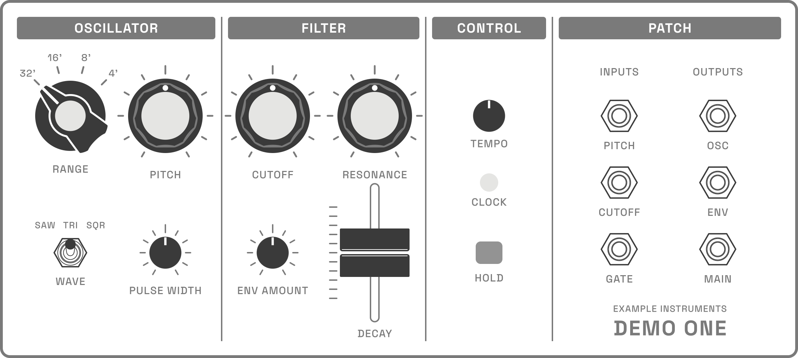

# Synth Patch Source

Open documentation for the file formats behind [Synth Patch](https://synthpatch.io): how a hardware synth is described as panel art plus a list of controls, and how a patch for that synth is written down. The synths in the app, and their patches, are kept separately. 



## Formats

Two formats (so far). Both are plain JSON and SVG.

- **`synthjson/1`, a synth package.** A folder with `synth.json`, the panel art, and one SVG per control state. See [Synth package](docs/synth-package.md) and [Controls](docs/controls.md).
- **`patchjson/1`, a patch.** One JSON file per patch, with knobs, switches and cables referenced by control name, so a patch can be written by hand from a patch sheet. A pack bundles many. See [Patches](docs/patches.md).

The `format` field carries the version. A change that breaks existing files gets a new number.

## Layout

```
docs/
  synth-package.md     synthjson/1: folder, synth.json, coordinates, assets
  controls.md          every control type, its config and its patch value
  patches.md           patchjson/1: patch files, cables, sources, packs
examples/
  synths/example-instruments/demo-one/          a complete synth package
  patches/example-instruments/demo-one/         three patches for it
  patches/packs/example-instruments-demo-one.json
```

## The example synth

Demo One by Example Instruments isn't a real instrument. It was drawn in the Synth Patch Figma file for these docs, with the same components and conventions as the synths in the app: 17 controls covering knobs, a rotary switch, a toggle, a fader, an encoder, an LED, a button, and a six-jack patch bay. Every file in its package is real output from that build, and its patches pass the same checks as the library's.

See [Demo One](examples/synths/example-instruments/demo-one/README.md) for its controls, placement dots, and how it was built.

## License

The docs, the format specs and the examples (JSON, SVG and PNG files) are licensed under [CC BY 4.0](LICENSE). Use them, adapt them, build on them, including commercially; credit Synth Patch by Human Crafted LLC. The code (`examples/synths/example-instruments/demo-one/source/build_synth_json.py`) is under the [MIT License](LICENSE-CODE).

Neither license covers the Synth Patch name or logo.
