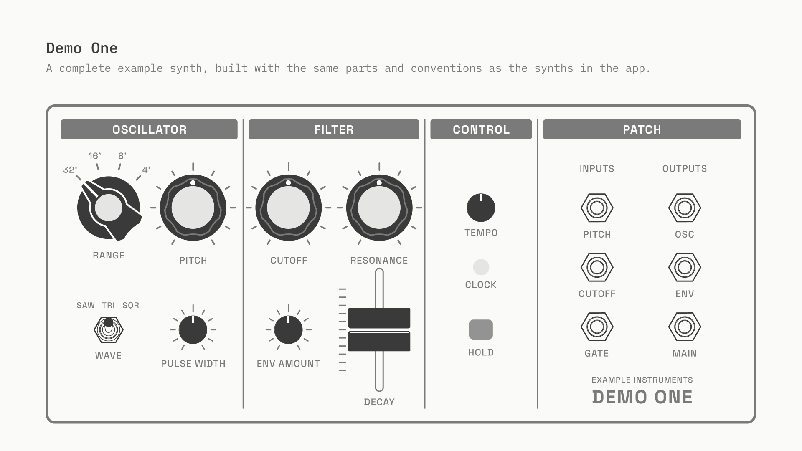
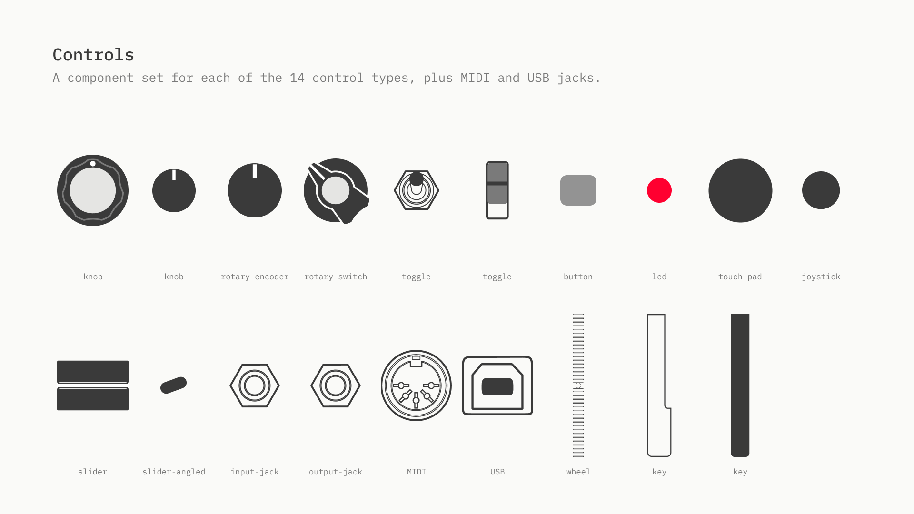

# Figma template

**[Synth Patch Source on Figma Community](https://www.figma.com/community/file/1696621078668432467)** is the Figma file Demo One was built in, free to duplicate. Use it to see how a drawn synth is put together, or as the starting point for drawing your own.

## What's in it

The **Synth Patch Source** page has three sections:

- **Design System:** the 24 Synth Patch color styles, with dark-mode versions of the neutrals (see [Colors](synth-package.md#colors)).
- **Demo One:** the panel, built from components, with its frame, placement and thumbnail.
- **Components:** a component set for each of the 14 drawn control types, plus MIDI and USB jacks. Each set has its state variants plus `placement` and `empty`.

The **For Reference** page holds these docs' figures, the thumbnail and the Community images.

## How it maps to a package

Every file in [Demo One's package](../examples/synths/example-instruments/demo-one) was exported from this file:

| In Figma | In the package |
| --- | --- |
| The panel component, every control at its default | `demo1-thumbnail-2268w.png` and its dark version |
| An instance with every control set to `empty` | `demo1-frame-2268w.svg` |
| An instance with every control set to `placement` | `demo1-placement-2268w.svg`, whose dots give each control's `x`/`y` |
| Each component variant, except `placement` and `empty` | one SVG per control state, named `<set>=<variant>.svg` |
| Color styles | the colors in the SVGs |

The panel is drawn at 288 dpi, so 1 px in Figma is one frame pixel: Demo One is 200 mm wide and 2268 px. [Synth package](synth-package.md) has the conventions: [coordinates](synth-package.md#coordinates), [assets](synth-package.md#assets) and [file names](synth-package.md#file-names). Demo One's [README](../examples/synths/example-instruments/demo-one/README.md) describes how it was built.

## Drawing your own synth

1. Duplicate the file from Figma Community.
2. Draw the panel at 288 dpi, at the synth's real width (mm ÷ 25.4 × 288).
3. Copy the component sets you need, or draw new ones with the same variant names, `placement` and `empty`.
4. Build the panel as a component, then make the `empty` and `placement` instances.
5. Export the frame, placement, thumbnail and each control state, and write `synth.json` (Demo One's [`build_synth_json.py`](../examples/synths/example-instruments/demo-one/source/build_synth_json.py) is one way).

A [generated synth](synth-package.md#generated-synths) needs none of this: it's only `synth.json`, drawn from the [parts library](parts.md).
