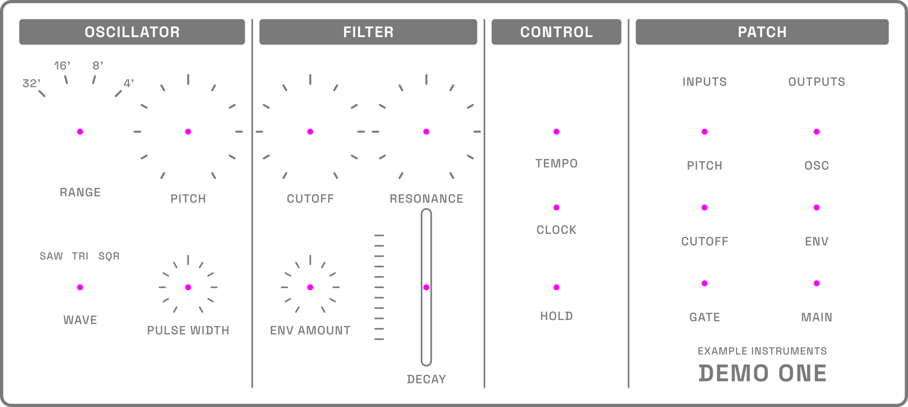
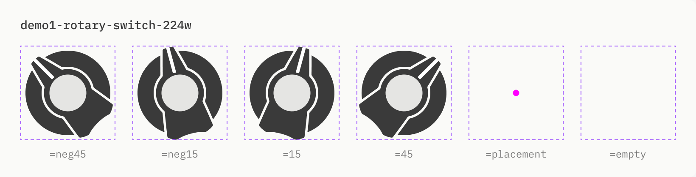

# Example Instruments Demo One

A made-up semi-modular synth for the format docs. 200 × 90 mm, so the frame is 2268 × 1020 px at 288 dpi.


## Controls

The placement SVG is the frame plus a 15 px magenta (#FF00FF) dot at each control's center. Each control's `x` and `y` in `synth.json` is its dot.



| Key | Type | Name | Notes |
| --- | --- | --- | --- |
| `circle_1` | rotary-switch | Oscillator Range | 4 positions: 32', 16', 8', 4' |
| `circle_2` | knob | Oscillator Pitch | bipolar |
| `circle_3` | knob | Filter Cutoff | |
| `circle_4` | knob | Filter Resonance | |
| `circle_5` | rotary-encoder | Tempo | |
| `circle_6` | input-jack | Pitch CV Input | |
| `circle_7` | output-jack | Oscillator Output | |
| `circle_8` | led | Clock Indicator | Off, On |
| `circle_9` | input-jack | Cutoff CV Input | |
| `circle_10` | output-jack | Envelope Output | |
| `circle_11` | input-jack | Gate Input | |
| `circle_12` | output-jack | Main Output | |
| `circle_13` | toggle | Oscillator Wave | Saw, Triangle, Square |
| `circle_14` | knob | Oscillator Pulse Width | |
| `circle_15` | knob | Filter Envelope Amount | bipolar |
| `circle_16` | slider | Filter Envelope Decay | vertical, 255 px travel |
| `circle_17` | button | Hold | latching |

The keys follow the placement dots' order: top to bottom, and left to right for dots less than 10 px apart vertically. The bottom jacks (y 710) sit exactly 10 px above the bottom row of controls (y 720), so they count as their own row and are numbered first.

## How it was built

Drawn in the Synth Patch Figma file, in the "Demo One" section, the same way as the synths in the app:

- **Components** are copies of house parts: the Grandmother-style knobs (212 and 91 px), jack, toggle, rotary switch, fader cap and LED, and the Mother-32 grey button. Each set has its state variants plus `placement` (a 15 px #FF00FF dot at the center) and `empty`.
- **The panel** is a component, `demo1-thumbnail-2268w`, with every control at its default variant. Instances of it with every control on `empty` and on `placement` give the frame and placement SVGs.
- **Knob scales** run ±150°, so the knobs' `minDegree`/`maxDegree` are −150 and 150. The fader's travel is the 393 px slot minus the 138 px cap.

The rotary switch's component set: one variant per position, each drawn already turned, plus `placement` and `empty`. Every variant shares the same 224 px canvas (dashed). Each position exports as a file named after its variant, like `demo1-rotary-switch-224w=neg45.svg`; `placement` and `empty` stay in Figma for the placement and frame SVGs.



`source/build_synth_json.py` writes `synth.json` from the control list:

```bash
python3 examples/synths/example-instruments/demo-one/source/build_synth_json.py
```
